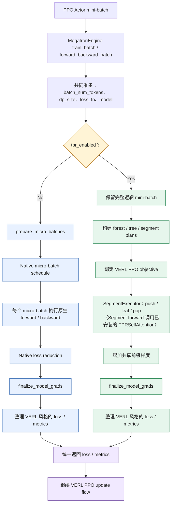

# TPR Recipe：架构与 VERL 集成说明

本文说明 TPR Recipe 的目录职责、与 VERL 现有训练框架的连接点，以及一批 PPO 轨迹在 TPR 路径中的执行流程。目标是让评审者先理解边界与数据流，再进入具体实现。

## 1. 一句话概括

**VERL 继续负责 PPO 训练编排；TPR Recipe 提供独立的训练侧前缀复用 Runtime；一个小型、版本锁定的 Patch 将 Runtime 接入 Megatron Engine。**

TPR 不替换 VERL 的 rollout、reward、PPO Trainer、优化器或学习率调度器。未启用 `tpr_enabled` 时，执行继续走 VERL 原有路径。

## 2. Recipe 代码组织

```text
tpr/
├── main entry / integration
│   ├── run_uniagent_rebench_ppo.sh  # UniAgent + SWE-ReBench PPO 示例入口
│   ├── verl-tpr.patch               # 针对固定 VERL revision 的最小集成补丁
│   ├── REQUIRED_VERL.txt            # 记录 Patch 对应的上游版本
│   ├── pyproject.toml               # 独立 Python 包元数据
│   ├── README.md                    # 安装与运行指引
│   └── ARCHITECTURE.md              # 本文：框架改动与执行流程
└── verl_tpr/
    ├── __init__.py                   # 包导出
    ├── adapter.py                   # VERL Engine 与 TPR Runtime 的适配入口
    ├── tree.py                      # 轨迹分组、树/森林执行计划与目标引用
    ├── executor.py                  # Segment 的 Push / Leaf / Pop 执行与反向传播
    ├── attention.py                 # 将共享前缀状态接入模型 Attention
    ├── context.py                   # 单次 Segment forward 的 Attention 上下文
    ├── state.py                     # Prefix KV、栈状态及延迟 dK/dV 累加
    ├── objective.py                 # 将原生 VERL PPO loss 映射到各 Segment
    ├── rectangular_attention.py      # CP=1 的矩形因果 Attention 路径
    ├── ring.py                      # Context Parallel Runtime 与 Ring 后端
    ├── ring_attention.py             # TPR 前缀块与 Ring Attention 的执行
    ├── ring_layout.py                # 序列分片、全局位置与 Ring 布局
    └── recompute.py                  # TPR 感知的重计算适配
```

Recipe 中保留的是 TPR 专属实现和运行示例，不复制完整 VERL 仓库。实验用例、轨迹准备、性能回放和调试脚本不属于最小 Runtime 包，应按各自用途留在测试或实验目录。

## 3. 对 VERL 现有框架的改动

固定上游版本：`2ab35292039a51175a4b3d3b3b2d76e951a0d3e4`。

TPR 通过一个全局开关 `tpr_enabled` 控制 Actor 训练执行路径：

- `tpr_enabled = false`：走 VERL 原生 Actor 训练执行路径。
- `tpr_enabled = true`：在满足 TPR 支持条件时，走 TPR Runtime。

### Patch 接入点

| 位置 | 修改或适配内容 | 作用 |
|---|---|---|
| VERL：`verl/workers/config/engine.py` | 增加 `tpr_enabled` 配置 | 显式选择 Native 或 TPR Actor 训练执行路径 |
| VERL：`verl/workers/engine/megatron/transformer_impl.py`，模型构建前 | 调用 `install_tpr_module_spec()` | 将各 Transformer layer 的 Attention ModuleSpec 接入 TPR 实现 |
| 同上，模型构建后 | 在启用重计算时调用 `install_tpr_full_recompute()` | 安装 TPR-aware 重计算适配，处理共享 KV 与对应的梯度关系 |
| 同上，训练执行入口 | 在原生 `prepare_micro_batches()` 之前调用 `run_tpr_forward_backward_batch()` | 保留完整逻辑 Actor mini-batch，让 TPR 能在批次内构造共享前缀树 |
| Recipe：`tpr/verl_tpr/adapter.py` | 连接 VERL Engine、模型构建和 TPR Runtime | 负责 Attention ModuleSpec 替换、轨迹标识解析、并行拓扑与能力校验、Forest 构建调用、PPO objective 绑定、SegmentExecutor 调度、梯度 finalize 和结果整理 |
| Recipe：`tpr/verl_tpr/attention.py` | 实现 `TPRSelfAttention` | 在模型 Attention 层消费 TPR 上下文，读取共享 Prefix KV 并计算当前 Segment；不承担整个 mini-batch 的树调度 |
| Recipe：`tpr/verl_tpr/ring.py` 等 | 封装 TPR 的 Ring CP 执行，并调用 MindSpeed 现有 Ring 能力 | 承担 TPR Attention 的分布式执行；当前 Patch 不直接修改 Megatron-LM 或 MindSpeed 的核心源码 |

### 原生 SelfAttention 是在哪里替换的？

这是**模型构建阶段的一次性适配**，不是每个 PPO mini-batch 运行到分叉点时才发生的操作。

1. VERL 的 `verl/workers/engine/megatron/transformer_impl.py` 在构建 Megatron 模型前调用 `install_tpr_module_spec(self.provider, bridge=self.bridge)`。
2. Recipe 的 `tpr/verl_tpr/adapter.py` 包装模型的 `ModuleSpec` provider，找到每个 Transformer layer 的 `submodules.self_attention`，把其中的原生 `SelfAttention` module 替换为 `TPRSelfAttention`。使用 vanilla MBridge 时，也会在模型创建前包装对应的 layer-spec 获取入口。
3. `tpr/verl_tpr/attention.py` 中的 `TPRSelfAttention` 继承 Megatron 的 `SelfAttention`。没有 TPR Attention context 时，它回退到原生 `SelfAttention.forward()`；树形执行时，则读取共享 Prefix KV、计算当前 Segment 的 Attention，并把新 KV 写回 TPR context。

因此，我们没有直接修改 Megatron-LM / MindSpeed 的核心源码，也没有替换整个 TransformerBlock。我们通过 VERL 的模型构建适配点替换 Attention 的 ModuleSpec，并复用现有训练栈提供的模型组件与运行能力。

**它在流程中的位置：** 发生在训练开始前的模型构建阶段；每次 TPR 训练请求进入 `SegmentExecutor` 后，Segment 的模型前向才会调用已经构建好的 `TPRSelfAttention`。它属于 TPR 路线内部的 Attention 实现，不是 Native / TPR 的分叉点，也不需要在 SegmentExecutor 下另画并行分支。

### 为什么分叉点必须在 micro-batch 切分之前？

VERL 进入 `MegatronEngine.forward_backward_batch()` 后，会先完成两条路径都需要的通用准备，包括全局监督 token 数、DP 元信息，以及相关的模型并行检查。

随后才决定执行路径：

- **Native 路线**：进入 VERL 原生的 `prepare_micro_batches()`，再按原生 Megatron forward/backward schedule 执行。
- **TPR 路线**：保留完整逻辑 mini-batch，先构造 forest / segment plans，再由 TPR Executor 安排共享前缀与叶子分支的前反向执行。

如果 TPR 在原生 micro-batch 切分之后才介入，共享前缀轨迹可能已经分散到不同 micro-batch，Runtime 就无法在原本的逻辑批次范围内发现并复用这些前缀。

### 我们是在什么范围内组树？

**当前是在单个逻辑 Actor mini-batch 内构建一棵或多棵树，组成一个 Forest；不会跨多个 mini-batch 保留轨迹并共同组树。**

具体来说，`run_tpr_forward_backward_batch()` 每次接收当前的 `data`，调用 `build_tree_execution_plans(keys, data)` 构建本批次的 Forest。构树时会按轨迹 UID 分组，并根据 token 完全匹配的消息边界识别共享前缀。一个 mini-batch 可以包含多个 UID 组，因此最终是一个 Forest，而不一定只有一棵树。

原生 micro-batch 切分会把一个逻辑 mini-batch 拆成更小的执行单元；TPR 必须在这一步之前组树，才能利用同一个逻辑 mini-batch 内不同轨迹的共享前缀。不同逻辑 mini-batch 之间不共享这棵树，也不复用彼此的 Prefix KV。

### 哪些框架能力保持不变？

- PPO 训练编排、rollout、Agent 运行、reward 计算和数据准备仍由 VERL / 上层应用负责。
- TPR 复用 VERL 原有的 Actor loss callback，不另起一套 PPO 算法。
- 参数、优化器、学习率调度和分布式进程组仍使用现有训练栈。
- 未启用 TPR 时，训练继续走原生执行路径；forward-only 请求也不会进入 TPR PPO 专用路由。
- 两条路线在各自完成梯度收尾并整理结果后，统一返回 VERL 预期的 loss / metrics 结构。

## 4. 一次训练请求如何经过 TPR？

同一个 PPO Actor mini-batch 在 Engine 完成公共准备后，根据 `tpr_enabled` 分成 Native 和 TPR 两条执行路线；两条路线完成各自的前反向与梯度收尾后，统一返回 VERL 需要的 loss / metrics。



**图中需要记住的两个位置：**

- **分叉点：** Engine 完成公共准备后、原生 `prepare_micro_batches` 之前。Native 路线照常切分 micro-batch；TPR 路线保留完整逻辑 mini-batch，以便构建共享前缀树。
- **汇合点：** 两条路线各自完成 `finalize_model_grads` 和 loss / metrics 整理后，统一返回 VERL。上层 PPO update flow 不需要改变。

## 5. 执行边界与重计算

- **唯一用户开关：** `tpr_enabled`。用户不需要额外选择 TPR 的 CP backend。
- **并行配置：** 沿用 VERL 现有配置，CP 执行细节由 TPR Runtime 内部处理；当前实现使用 Ring 路径。
- **DP：** 每个 DP replica 独立构造自己的 TPR forest，不跨 DP replica 共享 Prefix KV；梯度同步仍由现有 Megatron / VERL 训练路径负责。
- **重计算：** 沿用 Engine 的重计算配置，并安装对应的 TPR-aware 适配；当前仅支持已验证的配置组合。
- **Leaf batching：** 满足条件的叶节点可以在支持的执行路径中分组执行，不改变 VERL 的 PPO 编排。

## 6. 当前支持范围与限制

本 Recipe 对应当前已经实现和验证的范围，不代表所有模型与并行组合均已支持。

| 项目 | 当前代码中的限制 |
|---|---|
| 模型 | Dense Qwen / GPT 类路径；MoE、MTP 等不支持路径会显式拒绝 |
| 并行配置 | 沿用 VERL 现有配置；当前仅覆盖已验证的组合，超出支持范围会显式拒绝 |
| PP / VPP / EP | 当前训练路径要求 PP=EP=1，且只有一个模型 chunk |
| Sequence Parallel | 部分组合仍有限制；以启动前的能力校验为准 |
| 训练模式 | TPR 专用路由是 Actor forward/backward 训练路径，不是通用 inference / forward-only 路径 |
| PPO 目标 | 当前 Segment 目标适配限制为 vanilla policy loss 与 token-mean 聚合 |

超出支持范围的配置应在训练前失败，而不是静默回退或在一次 PPO 更新中途才暴露错误。

## 7. 验收状态

本文描述当前 Recipe 分支的代码结构与接入设计。公开提交前仍应在干净的固定版本 VERL checkout 上完成：

- `git apply --check` 与实际 Patch 应用；
- Python 包导入和 Hydra / Engine 配置检查；
- 最小 NPU PPO smoke test；
- Full / TPR 以及 recompute on / off 的最终对比实验；
- 对应性能、显存、前缀复用率和正确性结论的结果归档。

在上述检查完成前，Patch 与统一启动脚本应标记为待验收草稿，而不应宣称已经在干净上游环境中完成端到端验证。
